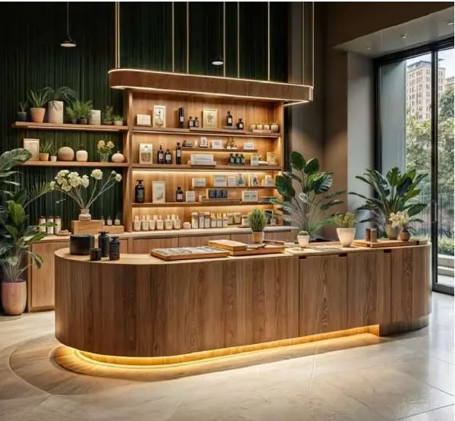
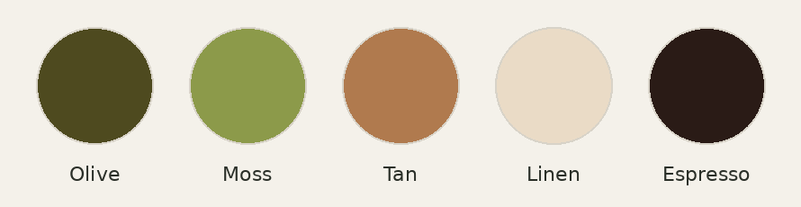
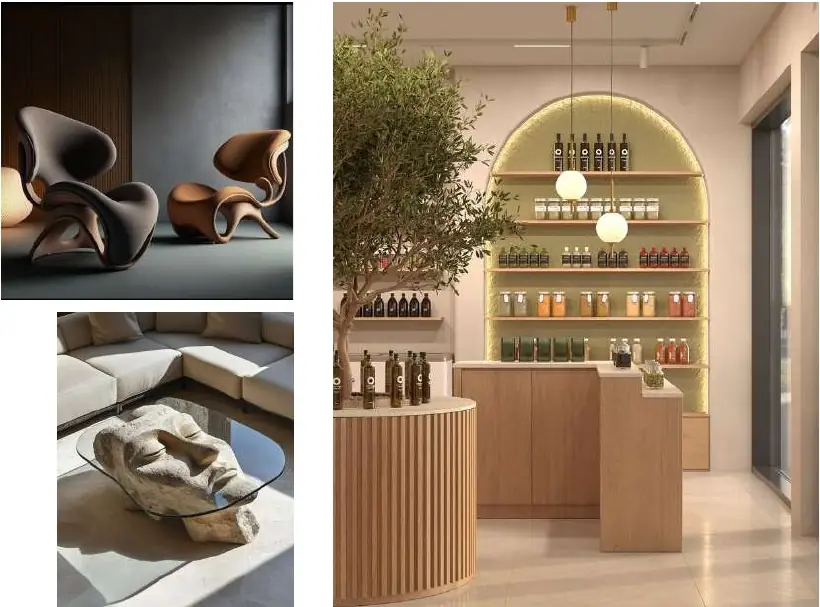
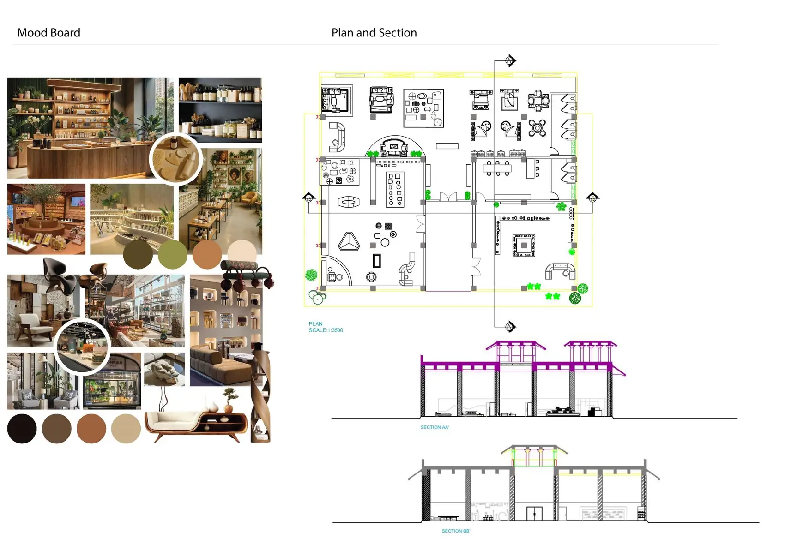

# Manek Chowk: Multifunctional space

*A beauty store and furniture gallery in one*

Concept view of the beauty store counter

| | |
|---|---|
| **Semester / context** | Studio project |
| **Type** | Multifunctional space |
| **Location** | Manek Chowk, Ahmedabad |
| **Programme** | Beauty retail store, furniture exhibition space |
| **Focus** | Space planning, retail design, product display, functional zoning |

## Design brief

Transform an existing space at Manek Chowk into a working commercial environment with a beauty store and a furniture exhibition space, using careful space planning, product display and activity zoning.

## Concept

The existing structure is reused and given a new purpose. Separate zones for the beauty store and the furniture gallery make better use of the space, creating a place that draws people in throughout the day.

## Colour palette

## Drawings and views

### Reference imagery for furniture and display

### Moodboard, plan and sections

---

Designed by **Pankti Shah**, Bachelor of Design (Interior Design), Indus Design School, Indus University, Ahmedabad.

Full portfolio: [pankti1305.github.io](https://pankti1305.github.io)  
Contact: [pankti1305@gmail.com](mailto:pankti1305@gmail.com)
